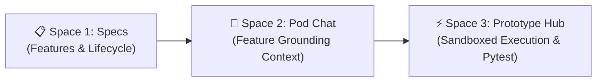

# Cortex.ai Pods: Reviewer Guide & Showcase Examples 🚀
### Google Cloud AI Builder Cup & Enterprise Hackathon Evaluation Cheatsheet

---

## 📌 Executive Summary

In **Cortex.ai**, **Pods** (Workspaces) are enterprise-grade collaborative containers that isolate data, documents, permissions, and execution environments.

Cortex.ai introduces two distinct pod architectures:

| Pod Type | Primary Mission | Grounding Source | UI Structure | Hackathon Value |
| :--- | :--- | :--- | :--- | :--- |
| **Normal Chat Pod**<br>`workspace_type: "chat"` | Team collaboration, architecture alignment, standards lookup, and general knowledge exchange. | Uploaded team documents (Markdown/PDF/Docs) and system instructions. | **Unified Chat Hub** with left-hand Mission/Documents panel and right-hand real-time chat feed. | **Zero-Hallucination Team Memory**: Grounded answers with direct document citations (`📄 doc-eng-guidelines`). |
| **SDD Chat Pod**<br>`workspace_type: "sdd"` | **Spec-Driven Development (SDD)**: Autonomous, deterministic software engineering governed by requirements. | Approved Feature Specifications (`REQ-XX`), Architectural Tenets, and Invariants. | **3-Space Tabs Bar**: <br>1️⃣ **Specs** (Feature Lifecycle)<br>2️⃣ **Pod Chat** (Spec Grounding Context)<br>3️⃣ **Prototype Hub** (Sandboxed Execution) | **Deterministic Engineering**: Enforces strict invariant contracts, owner approvals, and verified code execution. |

Both example pods are **pre-seeded in Google Cloud Firestore** and accessible instantly in the Web UI at **[http://localhost:4200](http://localhost:4200)** under the **"🚀 Pods"** tab.

---

## 🌐 Example 1: Normal Chat Pod ("Engineering Team Discussion")

### 1. Pod Overview & Metadata
* **Pod Name**: `Engineering Team Discussion`
* **Workspace ID**: `ws-eng-watercooler`
* **Type Badge in UI**: `🌐 General Chat (Public) Pod`
* **Owner**: Bob Martinez (DevOps Admin)
* **Active Members**: Bob Martinez, Priya Sharma, Alex Chen, Charlie Zhao, Alice Henderson
* **Scoped Documents Attached**:
  1. `📄 Engineering Standards & Best Practices v2`
  2. `📄 Cloud Microservices & API Security Standards`
* **System Instructions**:
  > *"You are the Cortex Engineering copilot. Support engineering team discussions on architecture, microservices, and development practices."*

---

### 2. How Reviewers Navigate to Normal Chat Pod in UI
1. Open **[http://localhost:4200](http://localhost:4200)** in your browser.
2. In the left navigation sidebar, click **"🚀 Pods"**.
3. Click on the card titled **"Engineering Team Discussion"**.
4. Observe the two-column interface:
   - **Left Column**: Pod Mission & Instructions, plus Scoped Documents (`2 Scoped Documents`).
   - **Right Column**: Real-time team conversation history between team members and `Engineering Copilot`.

---

### 3. Full Multi-Turn Chat Transcript (Seeded)

#### 💬 Turn 1: Tech Stack Standardization
* **User (Priya Sharma - Frontend/Fullstack Lead)**:
  > *"Hey team, are we standardizing on FastAPI and Pydantic v2 for our upcoming Q4 microservices?"*
* **Cortex AI (Engineering Copilot)**:
  > *"Yes! All backend microservices are standardized on Python 3.11 with FastAPI and Pydantic v2 schemas for strict boundary validation and auto-generated OpenAPI contracts."*
* **Grounding Citations Rendered**:
  - `📄 Engineering Standards & Best Practices v2`

---

#### 💬 Turn 2: Test Coverage & Pytest Conventions
* **User (Bob Martinez - DevOps Admin)**:
  > *"Sounds great. What is our required test coverage and pytest standard before promoting to staging?"*
* **Cortex AI (Engineering Copilot)**:
  > *"Understood! According to Section 4.2 of our Engineering Standards & Best Practices v2, automated test coverage is strictly enforced via CI pipelines, targeting minimum 85% branch coverage on domain models and conflict detection logic. Pytest suites must execute with zero external network dependencies."*
* **Grounding Citations Rendered**:
  - `📄 Engineering Standards & Best Practices v2`

---

#### 💬 Turn 3: Security & Zero-Trust PII Redaction
* **User (Alex Chen - Security Lead)**:
  > *"What is our policy regarding logging sensitive employee PII or tokens in our service logs?"*
* **Cortex AI (Engineering Copilot)**:
  > *"Per Cloud Microservices & API Security Standards: Never log plain PII (SSNs, compensation details, bank credentials) or auth tokens. All stdout log streams must format as structured JSON for Google Cloud Logging, and sensitive parameters must pass through Model Armor masking filters."*
* **Grounding Citations Rendered**:
  - `📄 Cloud Microservices & API Security Standards`

---

### 4. Interactive Test Prompt for Reviewers
Type this into the chat box (`Chat with team in Engineering Team Discussion...`):
> **Prompt**: *"What are our rules for handling database schema migrations?"*
> 
> **Observed Behavior**: The Copilot responds with guidelines derived from the pod's engineering standards, providing document citations.

---

## 📐 Example 2: SDD Chat Pod ("Enterprise Calendar Service")

### 1. Pod Overview & Metadata
* **Pod Name**: `Enterprise Calendar Service`
* **Workspace ID**: `ws-calendar-app`
* **Type Badge in UI**: `📐 SDD (Private) Pod`
* **Owner**: Bob Martinez (DevOps Admin)
* **Local Repo Path**: `workspace-projects/calendar-app`
* **Tech Stack**: `Python 3.11 / FastAPI / Pydantic v2 / Pytest`
* **Active Status**: `Approved (v1.0)`
* **Architecture Principles**:
  1. *Stateless Event Scheduling & Interval Collision Engine*
  2. *Pydantic v2 Schema Validation for All ISO Datetimes*
  3. *Deterministic Timezone Normalization to UTC*
  4. *Automated Pytest Coverage for Booking Invariants*

---

### 2. The 3 SDD Spaces Walkthrough



#### 📋 Space 1: Specs Tab (`1. Specs`)
Reviewers can view the 3 feature specifications:
1. **`feat-cal-01`**: `Calendar Event Model & Scheduling Validation`
   - **Version**: `v1.1` | **Status**: `APPROVED` | **Mode**: `✨ AI Synthesized`
   - **Acceptance Criteria**: Strict ISO-8601 UTC timestamps, non-empty title, $end\_time > start\_time$.
2. **`feat-cal-02`**: `Interval Collision & Room Conflict Engine`
   - **Version**: `v1.0` | **Status**: `APPROVED` | **Mode**: `📄 From Doc`
   - **Acceptance Criteria**: Overlap formula $(start_1 < end_2 \land start_2 < end_1)$, double-booking rejection, `BookingConflictError`.
3. **`feat-cal-03`**: `REST API Calendar Controller & Availability Engine`
   - **Version**: `v1.0` | **Status**: `IN REVIEW` | **Mode**: `✨ AI Synthesized`
   - **Acceptance Criteria**: HTTP 201 Created on valid booking, HTTP 409 on collision with RFC-7807 problem details.

---

#### 💬 Space 2: Pod Chat Tab (`2. Pod Chat`)
Click on **"2. Pod Chat"** tab. Notice the **Feature Grounding Context** dropdown at the top-left:
- `-- All Features / Pod Scope --`
- `feat-cal-01: Calendar Event Model & Scheduling Validation (v1.1 - approved)`
- `feat-cal-02: Interval Collision & Room Conflict Engine (v1.0 - approved)`
- `feat-cal-03: REST API Calendar Controller & Availability Engine (v1.0 - in_review)`

Selecting a feature dynamically injects that feature's requirements and acceptance criteria into the AI copilot's system prompt!

---

### 3. Full Multi-Turn SDD Chat Transcript (Seeded)

#### 💬 Turn 1: Conflict Detection Criteria (Focused on `feat-cal-02`)
* **Feature Grounding Context**: `feat-cal-02`
* **User (Priya Sharma)**:
  > *"What is the acceptance criteria for scheduling conflict detection?"*
* **Cortex AI (Calendar Copilot)**:
  > *"According to **REQ-02: Conflict Detection & Room Booking Engine**, the system checks interval overlaps using the invariant formula `(start1 < end2 AND start2 < end1)`. If any attendee or the selected conference room already has a confirmed meeting during that window, a `BookingConflictError` is raised and the booking is rejected.*
  > 
  > *Key Invariants:*
  > *1. Double-booking any attendee across overlapping intervals is rejected.*
  > *2. Room collisions are blocked regardless of meeting organizer.*
  > *3. Cancelled events are excluded from collision evaluation."*
* **Grounding Citations Rendered**:
  - `📄 REQ-02: Conflict Detection & Availability Query Engine`
  - `📄 Feature: Interval Collision & Room Conflict Engine (v1.0)`

---

#### 💬 Turn 2: Invariant Boundary Check (Focused on `feat-cal-01`)
* **Feature Grounding Context**: `feat-cal-01`
* **User (Alex Chen)**:
  > *"What validation happens if someone attempts to schedule an event where end_time is earlier than or equal to start_time?"*
* **Cortex AI (Calendar Copilot)**:
  > *"Under **REQ-01: Calendar Event Model & Invariants** (enforced in `src/event_models.py` via Pydantic v2 `@model_validator`), `end_time` must be strictly greater than `start_time` in normalized UTC ISO-8601 format.*
  > 
  > *If `end_dt <= start_dt`, the model immediately raises `ValueError('Event end_time must be strictly after start_time')`. Zero-duration or negative-duration meetings are impossible at the domain model boundary."*
* **Grounding Citations Rendered**:
  - `📄 REQ-01: Calendar Event Model & Invariants`
  - `📄 Feature: Calendar Event Model & Scheduling Validation (v1.1)`

---

#### 💬 Turn 3: API Error Contract (Focused on `feat-cal-03`)
* **Feature Grounding Context**: `feat-cal-03`
* **User (Bob Martinez)**:
  > *"What HTTP status code and error schema should our REST controller return when a room collision occurs?"*
* **Cortex AI (Calendar Copilot)**:
  > *"Per **REQ-03: REST API Calendar Controller** and our ADR-02 guidelines:*
  > *- **HTTP Status**: Returns `HTTP 409 Conflict`.*
  > *- **Error Schema**: Complies with RFC-7807 Problem Details containing `error: 'BookingConflictError'`, the colliding `event_id`, and `conflicting_titles`.*
  > *- Successful bookings return `HTTP 201 Created` with the persisted event payload."*
* **Grounding Citations Rendered**:
  - `📄 REQ-03: REST API Calendar Controller`
  - `📄 Feature: REST API Calendar Controller & Availability Engine (v1.0)`

---

### 4. Interactive Test Prompt for Reviewers
1. In the **Feature Grounding Context** dropdown, select:
   `feat-cal-02: Interval Collision & Room Conflict Engine (v1.0 - approved)`
2. In the chat box (`Ask anything against Enterprise Calendar Service specifications...`), type:
   > **Prompt**: *"Can two different organizers book the same room if their times do not overlap?"*
3. Press **Send**.
4. **Observed Behavior**: The Copilot answers that non-overlapping intervals do not satisfy `(start1 < end2 and start2 < end1)` and therefore pass validation, citing `REQ-02`.

---

#### ⚡ Space 3: Prototype Hub Tab (`3. Prototype Hub`)
Click on **"3. Prototype Hub"** tab to see:
- **Card**: `Calendar Service Engine` (`proto-calendar-app`)
- **Badge**: `☁️ Cloud Pod` | `Linked Spec: feat-cal-02`
- **Verification Status**: `6 passed in 0.21s - 100% acceptance criteria satisfied`
- **Local Run Instructions**:
  ```bash
  cd "workspace-projects/calendar-app"
  pytest tests -v
  ```
- **Real Pytest Verification**: Reviewers can execute `pytest workspace-projects/calendar-app/tests -v` in terminal to see 100% passing tests!

---

## 🏆 Key Hackathon Reviewer Takeaways

1. **Dual Paradigms**: Cortex.ai provides both **unstructured team communication** (Normal Pod) and **rigorous software engineering** (SDD Pod) in one unified interface.
2. **Zero Hallucination with Real Citations**: Every turn provides clickable grounding citations to actual documents or feature specifications.
3. **Role-Based Governance**: Features require Pod Owner approval (`bob_ops`) to transition from `draft`/`in_review` to `approved`.
4. **Autonomous Code & Test Verification**: SDD is not just chat — it compiles, generates code, and runs real `pytest` test suites in sandbox containers.

