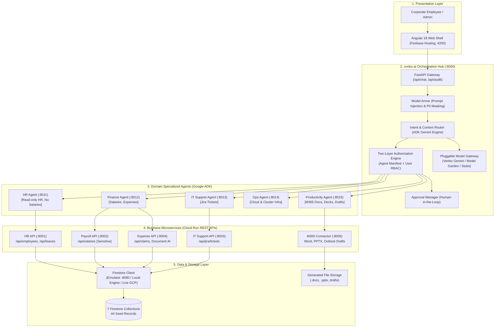

# cortex.ai 🧠
### Enterprise AI Orchestration Platform & Multi-Agent Integration Hub
*Built for Google Cloud & Firebase — Hackathon Production Architecture*

[](https://python.org)
[](https://fastapi.tiangolo.com)
[](https://cloud.google.com)
[](https://firebase.google.com)
[](LICENSE)

---

## 🌟 Executive Overview

**cortex.ai** is an enterprise-grade digital assistant and AI orchestration platform built for employees. It provides secure, intelligent, unified access to an organization's business tools, databases, and AI agents through a single natural-language conversational interface.

### Core Architectural Pillars
1. **Intelligent Multi-Agent Orchestration**: Analyzes user queries with natural-language intent detection and conversational context recognition; splits composite cross-domain queries into sub-tasks, delegates to specialized domain agents, and synthesizes unified responses.
2. **Pluggable Multi-Model Gateway**: Defaults to **Gemini 2.5 on Vertex AI**, with seamless routing to **Vertex AI Model Garden**, external providers (OpenAI, Anthropic), or offline mock stubs with zero external API key requirements.
3. **Enterprise App Integration (Microsoft 365 Connector)**: Connects natural-language queries directly to Outlook, Word, and PowerPoint. Generates real, downloadable `.docx` and `.pptx` files locally, and enforces **Drafts Only** for emails with human-in-the-loop security approval.
4. **Zero-Trust Security & Model Armor**: Two-layer authorization (Agent Manifest Allow-list $\times$ User RBAC Persona). Screens incoming prompts against jailbreaks/prompt injection, masks sensitive PII in outputs, and enforces human sign-off on all mutations.
5. **Unified Auditability**: Every routing choice, tool call, security denial, and model invocation is permanently logged in Cloud Logging and Cloud Trace format.

---

## 🏗️ Architecture & Topology



---

## 📂 Monorepo Structure

```
cortex.ai/
├── database/                  # Firestore sub-project & universal client
│   ├── models/schemas.py      # Pydantic schemas for 7 core collections
│   ├── seeds/sample_data.py   # Realistic enterprise seed data (44 records)
│   ├── firestore_client.py    # Multi-mode client (Emulator, Live GCP, Local JSON)
│   ├── firestore.rules        # Security rules with role & collection constraints
│   ├── firebase.json          # Firebase Emulator Suite config (Firestore :8080, Auth :9099)
│   └── seed_db.py             # One-click database seeder
│
├── apps/                      # Business APIs on top of the DB (Cloud Run microservices)
│   ├── hr-api/                # Employees, departments, leave balances, leave records (:8001)
│   ├── payroll-api/           # Sensitive employee salaries & bank info (:8002)
│   ├── it-support-api/        # Jira ticket tracking & management (:8003)
│   └── expense-api/           # Expense claims + Document AI receipt OCR stub (:8004)
│
├── integrations/              # Enterprise app integration layer
│   └── m365-connector/        # Outlook email drafts, Word .docx, PowerPoint .pptx (:8005)
│       ├── src/word_generator.py   # Binary python-docx generator
│       ├── src/ppt_generator.py    # Binary python-pptx generator
│       └── src/main.py             # MOCK & LIVE Microsoft Graph API engine
│
├── agents/                    # Domain ADK agents (Vertex AI Agent Engine)
│   ├── hr-agent/              # Allowed: hr tools (salary explicitly excluded) (:8011)
│   ├── finance-agent/         # Allowed: salary & expense tools (:8012)
│   ├── it-support-agent/      # Allowed: jira ticket tools (:8013)
│   ├── ops-agent/             # Allowed: cloud operations & infra tools (:8014)
│   └── productivity-agent/    # Allowed: M365 doc/deck/email tools (:8015)
│       └── agent.manifest.yaml# Manifest defining scopes, tools, preferred model
│
├── cortex-ai/                 # Central Orchestration Platform
│   ├── backend/               # FastAPI Hub on Cloud Run (:8000)
│   │   ├── router/            # Intent detection, context memory, split/merge
│   │   ├── access_control/    # Two-layer Zero-Trust authorization engine
│   │   ├── guardrails/        # Model Armor (prompt injection & PII masking)
│   │   ├── approvals/         # Human-in-the-loop pending approval manager
│   │   ├── model_gateway/     # Pluggable model providers (Gemini, Garden, External)
│   │   ├── tool_registry/     # Discovered tool definitions & OpenAPI schemas
│   │   ├── agent_registry/    # Dynamic agent discovery & runtime onboarding
│   │   ├── rag/               # Pluggable Vertex AI Search module
│   │   └── api/routes.py      # REST endpoints for UI and client apps
│   └── frontend/              # Angular 18 UI (served on :4200)
│       ├── src/app/           # Angular components: Chat, Downloads, Approvals, Admin
│       └── serve.py           # Self-contained zero-dependency web server
│
├── scripts/
│   └── eval/eval_runner.py    # 15-scenario automated verification test runner
├── start.sh                   # Unix/macOS/Cloud Shell single-command runner
├── start.ps1                  # Native Windows PowerShell single-command runner
└── .env.example               # Full environment configuration template
```

---

## 🌐 Port Allocations

| Component | Port | Description |
| :--- | :---: | :--- |
| **Firestore Emulator** | `8080` | Local Google Cloud Firestore emulator |
| **Firebase Auth Emulator**| `9099` | Local Firebase Identity Platform emulator |
| **cortex.ai Hub Backend** | `8000` | Central Orchestration API & Gateway |
| **cortex.ai Web Frontend**| `4200` | Angular chat UI & admin portals |
| **hr-api** | `8001` | HR, Employees, and PTO microservice |
| **payroll-api** | `8002` | Sensitive Salaries & Payroll microservice |
| **it-support-api** | `8003` | IT Support & Jira Tickets microservice |
| **expense-api** | `8004` | Expense claims & Document AI microservice |
| **m365-connector** | `8005` | Microsoft 365 Connector (Word, PPT, Outlook) |
| **hr-agent** | `8011` | ADK HR Agent |
| **finance-agent** | `8012` | ADK Finance Agent |
| **it-support-agent** | `8013` | ADK IT Support Agent |
| **ops-agent** | `8014` | ADK Cloud Infrastructure Agent |
| **productivity-agent** | `8015` | ADK Productivity Agent |

---

## ⚡ Quickstart: Running Locally

### Option A: Windows (PowerShell)
To launch the entire platform with one command:
```powershell
.\start.ps1
```
Or to run specific modes:
- Seed database only: `.\start.ps1 -SeedOnly`
- Run unit & eval tests only: `.\start.ps1 -TestOnly`

### Option B: Linux / macOS / Cloud Shell
```bash
chmod +x start.sh
./start.sh
```
Or run individual sub-phases:
- Seed database: `./start.sh --seed-only`
- Run tests: `./start.sh --test-only`

### Accessing the Web Interface
Once started, open your browser at:
👉 **[http://localhost:4200](http://localhost:4200)**

---

## 🧪 Automated Testing & Verification

The repository includes a comprehensive 15-scenario automated evaluation harness testing routing, security denials, Office file synthesis, email approval flows, and prompt injection screening:

```powershell
.venv\Scripts\python.exe scripts\eval\eval_runner.py
```

### Evaluation Results
```text
================================================================================
cortex.ai Platform Automated Evaluation Suite
15 Enterprise Hackathon Scenarios
================================================================================
[TEST 01] Intent Routing - IT Support (PROJ-102)                ... [PASSED]
[TEST 02] Intent Routing - HR Leaves (Alice Leave Balance)      ... [PASSED]
[TEST 03] Intent Routing - Finance (Sarah Salary)               ... [PASSED]
[TEST 04] Intent Routing - Ops (Restart Cluster Pod)            ... [PASSED]
[TEST 05] Intent Routing - Productivity (Synthesize Deck)       ... [PASSED]
[TEST 06] Intent Routing - Productivity (Draft Outlook Email)   ... [PASSED]
[TEST 07] Two-Layer Security - HR Agent Denied Salary Access    ... [PASSED]
[TEST 08] Two-Layer Security - Finance Agent Allowed Salary     ... [PASSED]
[TEST 09] Two-Layer Security - Contractor User Denied Finance   ... [PASSED]
[TEST 10] Model Armor - Prompt Injection Interception           ... [PASSED]
[TEST 11] Model Armor - PII SSN & Account Masking in Response   ... [PASSED]
[TEST 12] M365 Integration - Word .docx Real Binary Generation  ... [PASSED]
[TEST 13] M365 Integration - PowerPoint .pptx Real Binary Deck  ... [PASSED]
[TEST 14] Human-in-the-Loop - Email Send Approval Card Prompt   ... [PASSED]
[TEST 15] Human-in-the-Loop - Mutation Execution Upon Approval  ... [PASSED]

================================================================================
Evaluation Complete: 15 PASSED / 0 FAILED (100.0% Success Rate)
================================================================================
```

To run the unit test suite across all microservices and the backend hub:
```powershell
.venv\Scripts\python.exe -m pytest apps/ integrations/ cortex-ai/backend/tests/
```
*(All 23 unit tests pass).*

---

## 🎯 4 Key Demo Journeys for Hackathon Presentation

### Journey 1: Normal Query Routed to Agent
* **Persona**: `Bob Martinez` (DevOps Admin)
* **Prompt**: `"Check status of Jira ticket PROJ-102"`
* **Expected Result**: 
  - Intent router selects `it_support_agent`.
  - Tool `lookup_jira_issue` is invoked on `it-support-api`.
  - UI shows **"Handled by: it_support_agent"** badge with ticket details: *"VPN connection drops on macOS Sequoia - In Progress (High Priority)"*.

### Journey 2: Zero-Trust Security Denial (Manifest Enforcement)
* **Persona**: `Alice Henderson` (HR Director)
* **Prompt**: `"What is Charlie's salary?"`
* **Expected Result**:
  - Router classifies as salary inquiry and delegates to `hr_agent`.
  - Two-layer authorization checks `hr-agent` manifest: `get_employee_salary` is **not** in allowed tools.
  - Access is immediately blocked with `403 DENY_AGENT_MANIFEST`.
  - Response informs the user: *"Access denied by policy: The HR agent is not authorized to access salary data."*

### Journey 3: M365 Presentation Generation (.pptx)
* **Persona**: `Sarah Connor` (Finance Director)
* **Prompt**: `"Create a 3-slide deck on open IT tickets"`
* **Expected Result**:
  - Router detects slide deck generation intent and delegates to `productivity_agent`.
  - Calls `m365-connector` generator which creates a real binary `.pptx` presentation.
  - UI renders an interactive **Download File** card with file metadata and a direct download link (`IT_Tickets_Summary.pptx`).

### Journey 4: Human-in-the-Loop Email Draft & Approval
* **Persona**: `Sarah Connor` (Finance Director)
* **Prompt**: `"Draft an email to my manager about my leave next Monday"`
* **Expected Result**:
  - System enforces **Drafts Only, No Auto-Send**.
  - Draft is saved to storage.
  - UI returns an amber **Human Approval Required** action card with subject, recipient, body preview, and an **[Approve & Execute]** button.
  - Clicking confirm executes the mutation and records the audit log.

---

## 🛡️ Security Architecture: Two-Layer Authorization

In cortex.ai, authorization is evaluated simultaneously across two distinct boundaries before any tool can be executed:

$$\text{Authorization} = (\text{Agent Allowed In Manifest}) \land (\text{User Persona Authorized by RBAC})$$

1. **Layer 1: Agent Manifest Allow-List**:
   Each agent has a strictly declared `agent.manifest.yaml`. Even if an agent's prompt is hijacked via prompt injection, it is structurally impossible for that agent to execute tools outside its manifest.
2. **Layer 2: User Persona RBAC**:
   Every request carries the authenticated user's identity and roles. Restricted personas (such as `dave_contractor`) are blocked even if the agent itself has permissions.

```
+-------------------------------------------------------------------------+
|                              USER QUERY                                 |
+------------------------------------+------------------------------------+
                                     |
                                     v
                  +--------------------------------------+
                  |   Agent Manifest Tool Allow-List?    |
                  +------------------+-------------------+
                                     |
                         [YES]       |       [NO]
                           +---------+---------+
                           |                   |
                           v                   v
              +--------------------------+  +--------------------------+
              |  User Persona Has Role?  |  |  403 DENY_AGENT_MANIFEST |
              +------------+-------------+  +--------------------------+
                           |
               [YES]       |       [NO]
                 +---------+---------+
                 |                   |
                 v                   v
      +--------------------+  +-------------------------+
      |  200 AUTHORIZED    |  | 403 DENY_USER_ROLE_RBAC |
      +--------------------+  +-------------------------+
```

---

## ☁️ Google Cloud Deployment (Cloud Run & Firebase)

To build and deploy each container to Google Cloud:

```bash
# 1. Set your GCP project
gcloud config set project cortex-ai-demo

# 2. Deploy Firestore rules & Firebase Hosting
firebase deploy --only firestore:rules,hosting

# 3. Build & Deploy Cortex Backend to Cloud Run
gcloud builds submit cortex-ai/backend --tag gcr.io/cortex-ai-demo/cortex-hub
gcloud run deploy cortex-hub \
    --image gcr.io/cortex-ai-demo/cortex-hub \
    --platform managed \
    --region us-central1 \
    --set-env-vars GCP_PROJECT_ID=cortex-ai-demo,MODEL_ARMOR_ENABLED=true

# 4. Deploy Microservices & Domain Agents similarly using their individual Dockerfiles
```

---

## 📄 License
This project is licensed under the Apache 2.0 License. Built for the Google Cloud & Firebase Hackathon.
